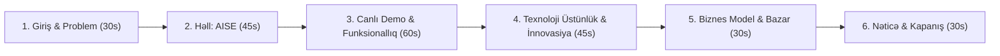

# 🚀 AISE — Hakaton Pitch Deck (3-5 Dəqiqəlik Təqdimat)

> **Format:** Hakaton Münsiflər Heyəti (Jury) qarşısında 3-5 dəqiqəlik təqdimat və Q&A sessiyası üçün hazırlanmış strukturlaşdırılmış çıxış planı və slayd bələdçisi.

---

## 📌 Pitch Strategiyası və Strukturu (Xülasə)



---

## Slayd 1: Giriş və Hook (Diqqəti Cəlb Etmə)

### 🖥️ Slaydda Nə Olmalıdır?
- **Başlıq:** AISE (aisehr.com) — Süni İntellekt Dəstəkli Fərdi Karyera və İrəliləyiş Ekosistemi
- **Alt Başlıq:** *"Doğru Vakansiya, Doğru İstedad, Sıfır Hallüsinasiya"*
- **Badge / Nişan:** 🏆 *ABB İnnovasiya 6-cı İnkubasiya Proqramı Rezidenti*
- **Vizual:** Müasir tünd yaşıl və parlaq laym rəngli minimalist loqo və məhsulun mock-up görüntüsü.

### 🎙️ Spikerin Nitqi (Nə Deməli?):
> *"Hörmətli münsiflər və iştirakçılar, hər birimiz həyatımızda ən azı bir dəfə iş axtarmışıq. Və hər dəfə eyni kabusla üzləşmişik: onlarla fərqli saytda eyni məlumatları təkrar-təkrar doldurmaq, hər vakansiyaya eyni şablon CV-ni göndərmək və heç vaxt geri dönüş almamaq. İşəgötürənlər isə minlərlə yararsız, vakansiyaya uyğun gəlməyən CV selində boğulur.*
>
> *Biz **AISE** komandası olaraq bu prosesi kökündən dəyişirik. AISE sadəcə bir iş elanı saytı deyil — namizədin fərdi süni intellekt karyera köməkçisi və işəgötürənin ağıllı filtridir."*

---

## Slayd 2: Problem (The Pain Points)

### 🖥️ Slaydda Nə Olmalıdır?
İki tərəfli bazar problemi (İnfoqrafika):

| 👤 Namizədlərin Ağrıları | 🏢 İşəgötürənlərin Ağrıları |
|---|---|
| **Parçalanmış Bazar:** Vakansiyalar 10+ fərqli portalda pərakəndədir. | **Zaman İtkisi:** Gələn CV-lərin 80%-i tələblərə uyğun deyil. |
| **Şablon və Səmərəsiz Sənədlər:** Vakansiyaya uyğunlaşdırılmamış standart CV-lər. | **Baha ATS Sistemləri:** Kiçik və orta biznes üçün xarici platformalar çox bahadır. |
| **Qaranlıq Boşluq:** "Niyə qəbul edilmədim?" sualına sıfır rəy və bacarıq analizi. | **Namizəd Boşluğu:** Vakansiya üçün lazım olan spesifik bacarığın yoxlanması çətindir. |

### 🎙️ Spikerin Nitqi:
> *"Azərbaycanda əmək bazarı həddən artıq parçalanıb. Namizəd bank vakansiyası üçün bir portala, IT üçün başqasına baxmalıdır. Ən pisi odur ki, namizəd öz real potensialını göstərə bilmir: ChatGPT-dən kopyalanan yalançı motivasiya məktubları isə şirkətlər tərəfindən dərhal zibil qutusuna atılır.*
>
> *İşəgötürən isə sadə bir elan üçün yüzlərlə uyğunsuz müraciəti tək-tək oxumağa günlərini xərcləyir."*

---

## Slayd 3: Həll (The Solution — AISE)

### 🖥️ Slaydda Nə Olmalıdır?
**AISE Ekosisteminin 4 Əsas Dayağı:**
1. 🔍 **Bütün Bazar Bir Yerdə:** Azərbaycanın 20+ əsas mənbəsindən (ABB, Kapital, Boss.az, Jobsearch, LinkedIn, Greenhouse) avtomatik toplanmış tək təmiz kataloq.
2. 🎯 **Ağıllı Uyğunlaşdırma (Skill-Gap Matcher):** Namizədin təcrübəsi ilə işin tələblərini analiz edən və çatışmayan bacarıqları göstərən alqoritm.
3. 📄 **Fakt-Əsaslı Harvard CV & Motivasiya Məktubu:** Namizədin həyatında olmayan heç bir yalanı uydurmayan, Typst ilə 1 saniyədə yığılan beynəlxalq standartlı sənəd.
4. 🤖 **Tək Kliklə İzləmə və Müraciət:** Təsdiqlənmiş e-poçt müraciətləri və Kanban tipli daxili müraciət izləyicisi (Application Tracker).

### 🎙️ Spikerin Nitqi:
> *"AISE bu xaosa son qoyur. Namizəd öz köhnə CV-sini və ya LinkedIn mətnini sistemə yükləyir. Sistem onu saniyələr içində analiz edir. Bir tərəfdən ölkənin bütün vakansiyalarını bir yerə toplayıb namizədin bacarıqları ilə müqayisə edir, digər tərəfdən isə hər bir vakansiya üçün xüsusi hazırlanmış sənəd generasiya edir.*
>
> *Ən əsası: **Sıfır yalan, sıfır hallüsinasiya!** Biz süni intellektə namizədin yerinə nağıl uydurmağa icazə vermirik — yalnız real faktları ən professional dillə ifadə edirik."*

---

## Slayd 4: Məhsul & Canlı Demo (Live Workflow)

### 🖥️ Slaydda Nə Olmalıdır?
Ekran görüntüləri və ya 30 saniyəlik canlı interfeys nümayişi:
1. **İstifadəçi Paneli (`/dashboard`):** Şəxsi profil və bacarıq matrisi.
2. **Vakansiya Səhifəsi:** *"85% Uyğunluq"* etiketi və *"Səndə olanlar vs Tələb olunanlar"* qarşılaşdırması.
3. **Harvard CV Generatoru:** Typst mühərriki ilə milisaniyələrdə tərtib olunan mükəmməl PDF.
4. **Avtomatlaşdırılmış Müraciət:** İşəgötürənin rəsmi emailinə sənədlərin birbaşa çatdırılması və Resend vasitəsilə çatdırılma statusu.

### 🎙️ Spikerin Nitqi:
> *"Gəlin canlı baxaq. Mən sistemə daxil oluram. AISE mənim profilimi analiz edib göstərir ki, ABB-dəki bu vakansiya mənim bacarıqlarıma 85% uyğundur. Lakin vakansiya 'PostgreSQL' tələb edir, mənim profilimdə isə bu yoxdur. Sistem dərhal mənə xəbərdarlıq edir: 'Bu bacarığın varmı?'. Varsa təsdiqləyirəm, yoxdursa yalan məlumat əlavə olunmur.*
>
> *Daha sonra 'Sənəd hazırla' düyməsini sıxıram. 1 saniyə sonra qarşımda Harvard dizaynında təmiz PDF və təbii Azərbaycan dilində yazılmış motivasiya məktubu hazırdır. Bir kliklə müraciət göndərilir və mənim müraciət cədvəlimə qeyd olunur."*

---

## Slayd 5: Bizim "Super Gücümüz" (Texnoloji İnnovasiya)

### 🖥️ Slaydda Nə Olmalıdır?
Rəqiblərdən ayıran unikal mühəndislik həlləri:

```
┌────────────────────────────────────────────────────────┐
│             AISE MÜHƏNDİSLİK ÜSTÜNLÜKLƏRİ              │
├──────────────────────────┬─────────────────────────────┤
│ 1. Typst PDF Engine      │ LaTeX keyfiyyətində, amma   │
│                          │ 50 qat daha sürətli         │
├──────────────────────────┼─────────────────────────────┤
│ 2. Deterministic AI Gate │ Məzmunu yoxlayan daxili     │
│                          │ Fact-Checker (No hallucination)│
├──────────────────────────┼─────────────────────────────┤
│ 3. Yerli Dil Dəqiqliyi   │ Azərbaycan qrammatikası və │
│                          │ xüsusi simvol normalizatoru │
├──────────────────────────┼─────────────────────────────┤
│ 4. Python Matching Core  │ Semantik və leksik hibrid   │
│                          │ uyğunlaşdırma xidməti       │
└──────────────────────────┴─────────────────────────────┘
```

### 🎙️ Spikerin Nitqi:
> *"Niyə adi bir ChatGPT botu deyil? Çünki arxada ciddi mühəndislik dayanır:*
> 1. *Biz PDF generasiyası üçün köhnəlmiş ağır kitabxanalar deyil, ən müasir **Typst** mühərrikindən istifadə edirik.*
> 2. *Bizim **Fakt-Yoxlayıcı (Fact-Checker)** modulumuz var — süni intellekt mətni yazdıqdan sonra ikinci bir model həmin mətni namizədin profili ilə tutuşdurur, uyğunsuzluq varsa mətni rədd edir.*
> 3. *Və ən başlıcası — **Doğma dilimiz.** Sistemimiz Azərbaycan hərflərini, qrammatikasını və işgüzar yazı üslubunu mükəmməl tanıyır."*

---

## Slayd 6: Bazar və Biznes Model (Traction & Monetization)

### 🖥️ Slaydda Nə Olmalıdır?

#### 💰 Monetizasiya Modeli:
- **B2C (Namizədlər üçün):**
  - *Freemium:* 5 pulsuz sənəd və müraciət.
  - *Plus (8 AZN/ay):* Aktiv iş axtaranlar üçün 30 sənəd + prioritet bildirişlər.
  - *Premium (15 AZN/ay):* Limitsiz sənəd + 100 email müraciəti + Brauzer köməkçisi.
- **B2B (İşəgötürənlər üçün):**
  - *Tək vakansiya:* 20 AZN (30 günlük).
  - *Biznes Abunəlik:* 100 AZN/ay (Limitsiz vakansiya + daxili namizəd idarəetməsi).

#### 📈 Mövcud Vəziyyət (Traction):
- **ABB İnnovasiya 6-cı İnkubasiya Proqramı** rəsmi rezidenti.
- Bazadan toplanmış **1,500+ aktiv vakansiya** və **290+ qeydiyyatdan keçmiş şirkət profili**.
- İnteqrasiya olunmuş **20+ mənbə və ATS sistemi**.

### 🎙️ Spikerin Nitqi:
> *"Biznes modelimiz sadə və sübut olunmuşdur: Həm namizədlər, həm də şirkətlər üçün sərfəli abunəlik. Namizədlər üçün ayda cəmi 8-15 AZN-ə şəxsi karyera meneceri təqdim edirik. Şirkətlər üçün isə aylıq 100 AZN-ə limitsiz elan və ilkin süzgəcdən keçmiş namizəd axını təklif edirik.*
>
> *Biz artıq ideya mərhələsində deyilik — **ABB İnnovasiyanın rəsmi rezidentiyik**, bazada minlərlə real vakansiyamız toplanıb və texnoloji infrastrukturumuz tam işlək vəziyyətdədir."*

---

## Slayd 7: Yol Xəritəsi və Baxış (Roadmap & Vision)

### 🖥️ Slaydda Nə Olmalıdır?
- **Q1 2027:** Azərbaycan bazarında kütləvi istifadəçi bazasına çatmaq (10,000+ aktiv namizəd, 100+ ödənişli şirkət).
- **Q2 2027:** Chrome Web Store-da rəsmi süni intellekt müraciət agentinin buraxılışı.
- **Q3 2027:** Təhsil mərkəzləri və universitetlər üçün "Academy / Karyera Mərkəzi" B2B portalının istifadəyə verilməsi.
- **Q4 2027:** Region bazarlarına (Qazaxıstan, Özbəkistan və Gürcüstan) çıxış.

### 🎙️ Spikerin Nitqi:
> *"Bizim vizyonumuz sadəcə bir vakansiya saytı olmaq deyil. Biz Azərbaycanda hər bir gəncin, tələbənin və peşəkarın cibində gəzdirdiyi şəxsi karyera məsləhətçisi olmaq istəyirik. Yaxın gələcəkdə universitetlərlə əməkdaşlıq edərək məzunların birbaşa şirkətlərə inteqrasiyasını təmin edəcəyik."*

---

## Slayd 8: Komanda və Çağırış (Call to Action)

### 🖥️ Slaydda Nə Olmalıdır?
- **Komanda üzvləri və rolları:** Backend, Frontend, AI/ML və Biznes İnkişaf.
- **Əlaqə:** `ceo@aisehr.com` | [aisehr.com](https://aisehr.com)
- **Güclü Şüar:** *"Gələcəyin iş axtarışı artıq burada — AISE ilə bir addım öndə."*

### 🎙️ Spikerin Nitqi:
> *"Bu gün bizimlə birlikdə karyera axtarışını əziyyətdən çıxarıb fürsətə çevirmək üçün sizləri AISE-ni sınaqdan keçirməyə dəvət edirik. Diqqətiniz üçün təşəkkür edirik! Suallarınızı cavablandırmağa hazırıq."*

---

## 🛡️ Hakaton Münsiflərinin Verəcəyi Ən Çətin Suallar və Qalib Cavablar (Q&A Prep)

### Sual 1: "ChatGPT-dən və ya mövcud vakansiya saytlarından (Boss.az, Jobsearch) sizin fərqiniz nədir?"
> **Cavab:**
> *"Mövcud vakansiya saytları sadəcə passiv elan lövhələridir (bulletin boards). Onlar namizədə heç bir kömək etmir. ChatGPT isə ümumi mətn yazır, amma ölkədəki real vakansiyalardan bixəbərdir və ən pisi — hallüsinasiya edir (olmayan təcrübələr uydurur).*
>
> *AISE isə bu ikisini birləşdirir: bir tərəfdə real Azərbaycan bazarı vakansiyaları var, digər tərəfdə isə namizədin real faktlarını heç nə uydurmadan mükəmməl Harvard formatına çevirən və dərhal işəgötürənin tələbinə uyğunlaşdıran ixtisaslaşmış mühərrik var."*

### Sual 2: "İşəgötürənlər süni intellektlə yazılmış müraciətləri necə qarşılayır? Spam kimi görünməyəcəkmi?"
> **Cavab:**
> *"Əksinə! İşəgötürənlər şablon və uyğunsuz müraciətlərə nifrət edirlər. AISE heç vaxt spam göndərmir. Birincisi, hər bir müraciət namizədin şəxsi təsdiqindən keçir (avtonom rejim namizədin nəzarətindədir). İkincisi, bizim fakt-yoxlayıcı sistemimiz mətndə yalnız vakansiya tələblərinə cavab verən real sübutları saxlayır. Bu, işəgötürən üçün zibil deyil, axtardığı ən dəqiq cavab olur."*

### Sual 3: "Sizin platformanızda olan vakansiyaların həqiqiliyini necə qoruyursunuz?"
> **Cavab:**
> *"Bizim xüsusi toplayıcı (collector) alqoritmimiz vaxtı keçmiş, təkrar və ya silinmiş vakansiyaları müntəzəm olaraq arxivləşdirir. Bundan əlavə, işəgötürənlərin birbaşa yerləşdirdiyi elanlar admin heyətimiz tərəfindən moderasiya olunur."*

### Sual 4: "Azərbaycan dilində AI modelləri adətən zəif işləyir. Siz bunu necə həll etmisiniz?"
> **Cavab:**
> *"Biz dili sırf ümumi AI modelinə həvalə etməmişik. Arxitekturamızda xüsusi 'az-language' və 'az-lexicon' qrammatika modulu var. Bu modul Azərbaycan hərflərini (İ-i, Ə-ə), söz birləşmələrini və standart işgüzar terminologiyanı yoxlayır və xətaları hələ sənəd çapa getməmiş düzəldir."*
